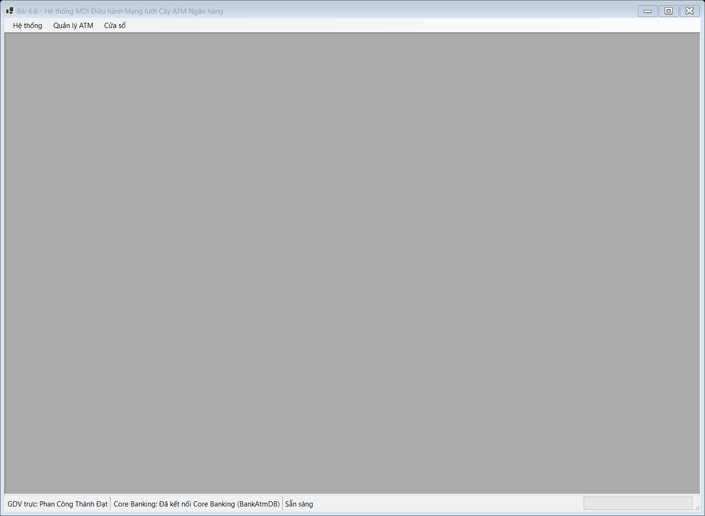
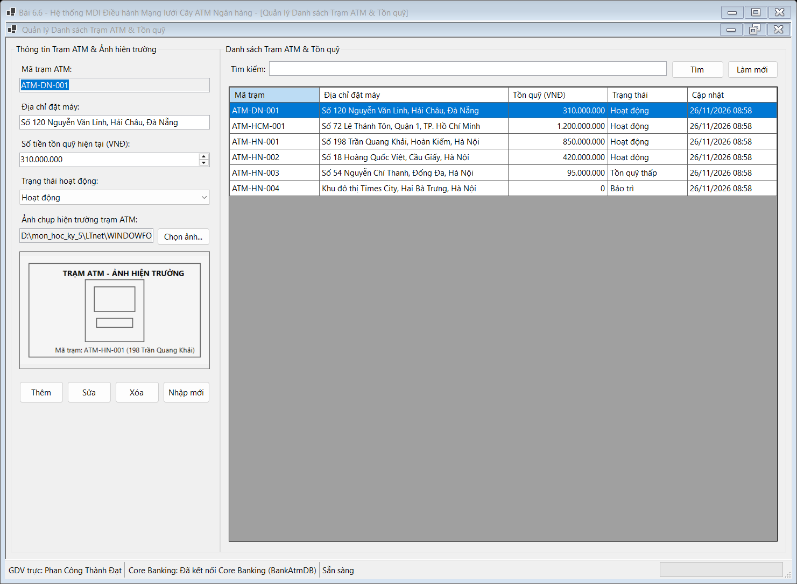
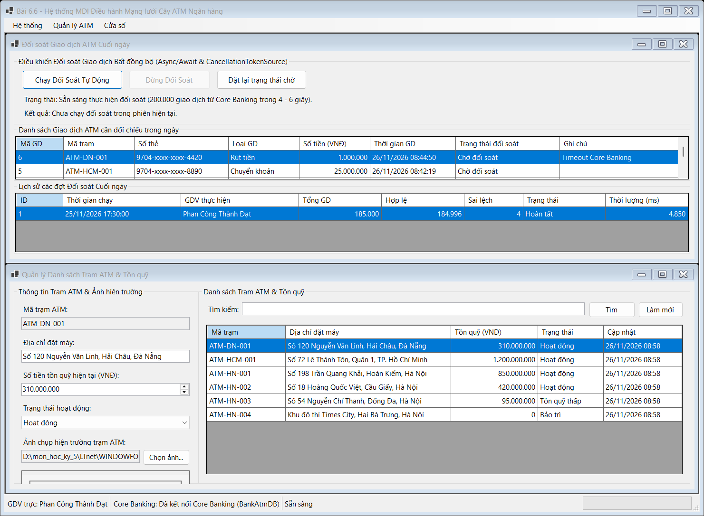
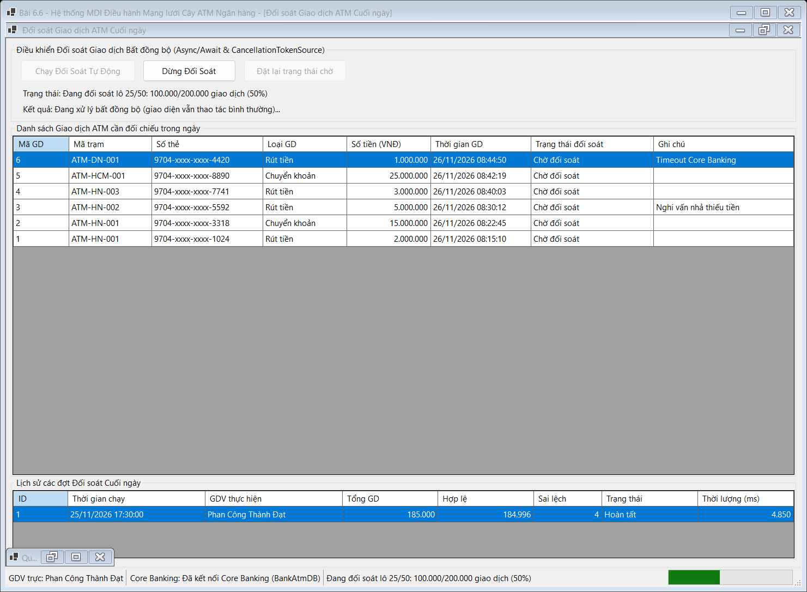
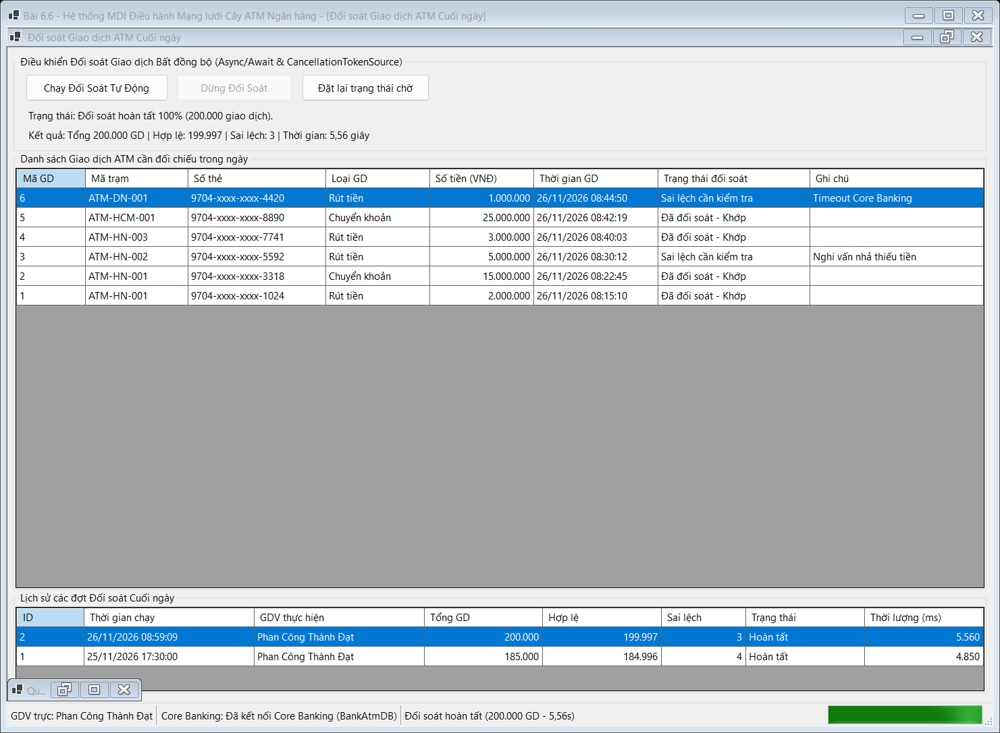

## MỤC 1: THÔNG TIN SINH VIÊN
- **Họ và tên sinh viên:** Phạm Hữu Hưng
- **Mã sinh viên:** 24810310239
- **Lớp:** D19CNPM3

## MỤC 2: HÌNH ẢNH KẾT QUẢ KIỂM THỬ CÁC MÀN HÌNH CHỨC NĂNG

### 1. Màn hình Chính MDI Parent (`frmBankAtmMain`):

### 2. Màn hình Quản lý Danh sách Trạm ATM, Tồn quỹ & Đính kèm ảnh (`frmAtmStations`):

### 3. Điều hướng MDI đa cửa sổ & Sắp xếp cửa sổ (`Tile Horizontal`):

### 4. Tiến trình Đối soát Giao dịch Bất đồng bộ đang chạy (50% - UI Thread không bị treo):

### 5. Kết quả Đối soát hoàn tất 100% (200.000 GD trong 5,56 giây) & Lưu lịch sử vào CSDL:

