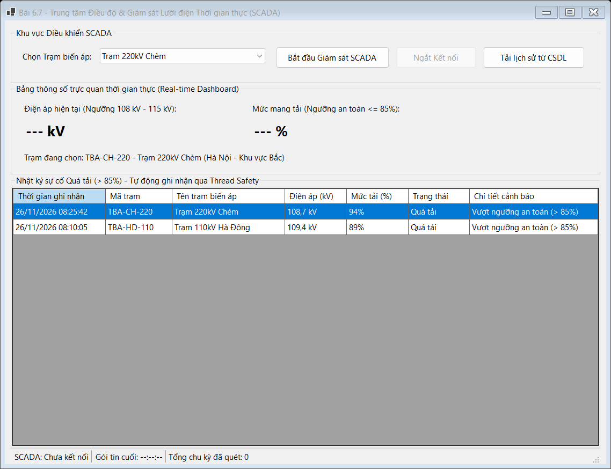
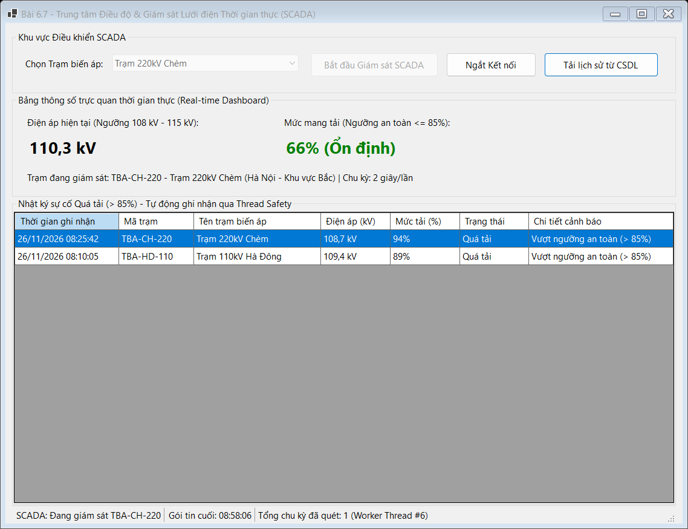
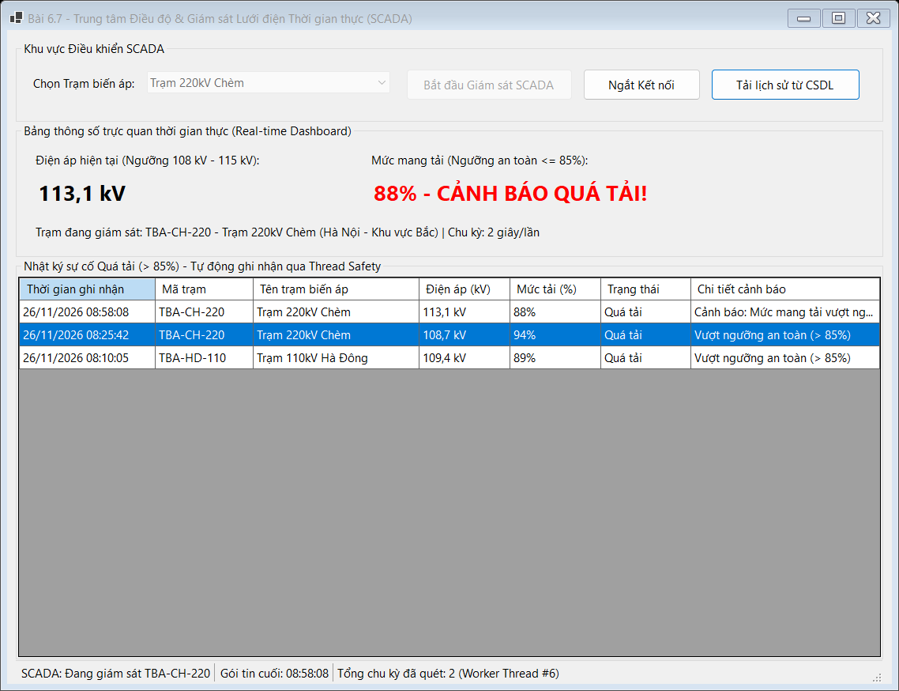
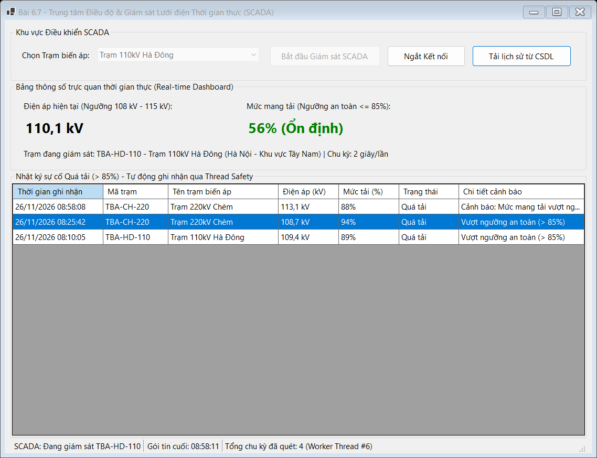
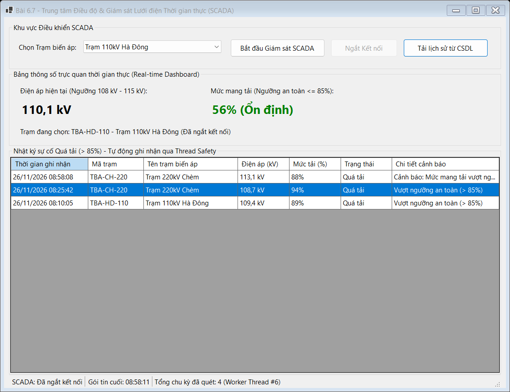

## MỤC 1: THÔNG TIN SINH VIÊN
- **Họ và tên sinh viên:** Phan Công Thành Đạt
- **Mã sinh viên:** 24810310223
- **Lớp:** D19CNPM3

---

## MỤC 2: HÌNH ẢNH KẾT QUẢ KIỂM THỬ CÁC MÀN HÌNH CHỨC NĂNG

### 1. Giao diện ban đầu (`frmPowerGridMonitor`) trước khi kết nối SCADA:

### 2. Trạng thái vận hành ổn định (Mức tải <= 85% hiển thị màu Xanh lá):

### 3. Cảnh báo Quá tải (> 85% đổi chữ Đỏ & tự động ghi nhật ký sự cố vào `dgvGridLogs`):

### 4. Chuyển đổi giám sát sang Trạm biến áp khác (`Trạm 110kV Hà Đông`) & đếm chu kỳ:

### 5. Ngắt kết nối SCADA an toàn & lưu giữ lịch sử sự cố quá tải:

